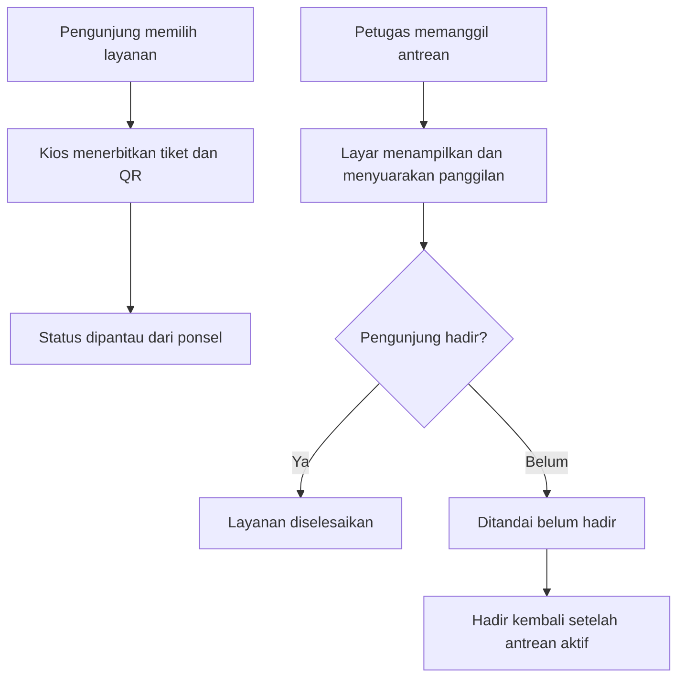

# Antrean731

Sistem antrean layanan berbasis web untuk kios, layar ruang tunggu, petugas loket, administrator, dan pemantauan mandiri melalui ponsel.

[](https://www.php.net/)
[](https://mariadb.org/)
[](https://github.com/mrifqis/aplikasi-antrean-web/actions/workflows/ci.yml)
[](LICENSE)

> Proyek portofolio oleh **Muhammad Rifqi Saifudin**. Repositori ini bukan aplikasi atau repositori resmi Direktorat Jenderal Pajak.

## Fitur utama

- Kios untuk memilih layanan, menerbitkan nomor, dan mencetak tiket thermal.
- QR unik pada tiket yang membuka status antrean tanpa mengetik nomor.
- Layar publik dengan nomor yang dipanggil, loket tujuan, ringkasan antrean, dan suara panggilan berbahasa Indonesia.
- Panel petugas untuk memanggil, memanggil ulang, menyelesaikan, dan menandai pengunjung belum hadir.
- Mekanisme **Hadir kembali**: tiket yang sebelumnya tidak hadir dapat dimasukkan setelah antrean aktif tanpa membuat nomor baru.
- Panel administrator untuk mengelola layanan, loket, dan pengguna.
- Dashboard harian, rata-rata waktu tunggu, tren tujuh hari, dan statistik per layanan.
- Pemisahan data berdasarkan kantor, jenis layanan, dan loket.
- Antarmuka responsif untuk kios, TV/monitor, desktop petugas, dan ponsel pengunjung.

## Alur aplikasi



## Teknologi

| Bagian | Teknologi |
|---|---|
| Backend | PHP 8.1+, PDO, session, CSRF protection |
| Database | MariaDB 10.6+ atau MySQL 8 |
| Frontend | HTML, CSS, JavaScript tanpa framework |
| Server | Nginx/Apache dan PHP-FPM |
| Fitur browser | Web Speech API dan dialog cetak |

Tidak ada proses build frontend atau ketergantungan Composer. Seluruh aplikasi dapat dipasang pada VPS kecil dengan PHP dan MariaDB.

## Persyaratan

- PHP 8.1 atau lebih baru dengan ekstensi `PDO` dan `pdo_mysql`.
- MariaDB 10.6+ atau MySQL 8+.
- Nginx atau Apache.
- HTTPS untuk penggunaan melalui internet.
- Browser modern. Ketersediaan suara Indonesia bergantung pada sistem operasi dan browser layar publik.

## Instalasi cepat

```bash
git clone https://github.com/mrifqis/aplikasi-antrean-web.git
cd aplikasi-antrean-web
cp config.example.php config.php
```

1. Buat database kosong beserta pengguna database khusus aplikasi.
2. Isi koneksi database dan `app_url` di `config.php`.
3. Arahkan document root web server ke direktori proyek.
4. Buka `/install.php` untuk membuat tabel, kantor pertama, dan administrator.
5. Setelah berhasil, **hapus atau blokir `install.php`**.
6. Masuk melalui `index.php?page=operator`, lalu tambahkan layanan, loket, dan petugas.

Panduan produksi yang lebih lengkap tersedia di [docs/DEPLOYMENT.md](docs/DEPLOYMENT.md). Contoh server block ada di [deploy/nginx-example.conf](deploy/nginx-example.conf).

## Halaman aplikasi

| Pengguna | URL |
|---|---|
| Kios | `index.php?page=kiosk&office=slug-kantor` |
| Layar publik | `index.php?page=display&office=slug-kantor` |
| Pelacakan tiket | `index.php?page=track` |
| Petugas dan admin | `index.php?page=operator` |

`slug-kantor` dibuat saat instalasi. Tautan QR menggunakan `app_url` dari `config.php`, sehingga alamat tersebut harus dapat diakses dari ponsel pengunjung.

## Struktur proyek

```text
.
├── assets/                 # CSS, JavaScript, dan aset antarmuka
├── deploy/                 # Contoh konfigurasi web server
├── docs/                   # Dokumentasi implementasi
├── api.php                 # Endpoint JSON aplikasi
├── config.example.php      # Template konfigurasi tanpa kredensial
├── db.php                  # Koneksi dan helper keamanan
├── index.php               # Seluruh halaman aplikasi
├── install.php             # Instalasi awal
└── schema.sql              # Skema basis data
```

## Keamanan dan privasi

- `config.php`, dump basis data, arsip, dan log dikecualikan melalui `.gitignore`.
- Password disimpan dengan `password_hash()` dan diverifikasi dengan `password_verify()`.
- Permintaan yang mengubah data memakai token CSRF.
- Query basis data menggunakan prepared statements.
- Tiket tidak memerlukan nama, NIK, NPWP, atau data identitas pengunjung.
- Produksi harus memakai HTTPS, password kuat, backup berkala, dan pembaruan server.

Lihat [SECURITY.md](SECURITY.md) untuk pelaporan kerentanan dan langkah hardening.

## Batasan versi saat ini

- Cetak tanpa dialog bergantung pada mode kios dan pengaturan browser/perangkat.
- Kualitas suara Indonesia bergantung pada voice pack yang tersedia pada perangkat layar.
- Installer membuat kantor pertama. Penambahan kantor melalui UI superadmin belum tersedia; kantor berikutnya dapat diprovisikan oleh administrator basis data atau dipasang sebagai instance terpisah.
- Pembaruan layar menggunakan polling berkala, belum memakai WebSocket.

## Roadmap

- Pengelolaan kantor melalui superadmin.
- Jam layanan dan penutupan antrean otomatis.
- Notifikasi progres antrean melalui kanal pilihan pengguna.
- Audit log aktivitas operator.
- Progressive Web App dan mode offline terbatas untuk kios.

## Lisensi dan merek

Kode sumber tersedia dengan [Lisensi MIT](LICENSE). Logo, nama, dan identitas visual instansi tidak termasuk dalam lisensi kode; lihat [NOTICE.md](NOTICE.md). Ganti aset identitas sebelum menerapkan aplikasi untuk organisasi lain.

## Pengembang

**Muhammad Rifqi Saifudin** — [GitHub @mrifqis](https://github.com/mrifqis)

